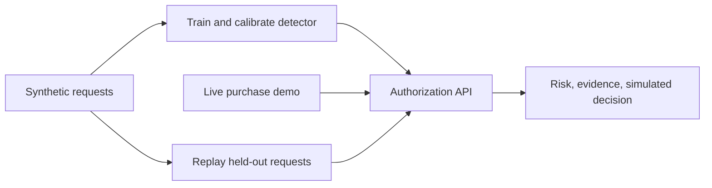

# Ticket scalper detection

A payment-side prototype for detecting suspicious ticket purchases across participating ticketing sites. A PyTorch LSTM and random forest score each request using the activity available at that time. A local authorization API returns the risk estimate, observed evidence, and a simulated merchant decision.

The repository includes synthetic data generation, model training and evaluation, HTTP replay, and a paced live demo. All decisions are advisory: no payment, cancellation, or refund is executed. Synthetic results require separate validation on representative ticket traffic.



| Component | Purpose |
| --- | --- |
| [Generator](generation_and_testing/README.md) | Seeded request streams, separate labels, and chronological source splits. |
| [Detector](detection/README.md) | Causal features, ensemble training, CSV scoring, and ranked review. |
| [Authorization API](datathon_authorization/README.md) | Request validation, shared scoring history, HTTP responses, and replay. |
| [Live demo](live_demo/README.md) | New purchases arriving over time, release surges, and live decisions. |

## Quick start

Use **Python 3.13** for the standard development setup; the package requires Python 3.10 or later. IBM LinuxONE users should follow the architecture-specific guide below, which includes Python 3.11/3.12 installation options. Run commands from the repository root. No generated dataset or pretrained model is committed.

Choose the guide for your computer. Each includes installation, checks, data generation, training, and the API/demo commands in the correct shell:

| Platform | Setup and run guide | Shell |
| --- | --- | --- |
| Linux | [Linux guide](docs/platforms/linux.md) | Bash |
| IBM LinuxONE / IBM Z (`s390x`) | [LinuxONE guide and crash recovery](docs/platforms/linuxone.md) | Bash |
| macOS (Apple silicon) | [macOS guide](docs/platforms/macos.md) | zsh or Bash |
| Windows | [Windows guide](docs/platforms/windows.md) | PowerShell |

All platforms use **one shared source tree**. Create a separate `.venv` on each operating system; virtual environments contain platform-specific executables and dependencies and must not be copied between computers. Linux and macOS share Unix command conventions, while Windows uses `Scripts` paths and PowerShell syntax. Separate operating-system branches are unnecessary for these setup differences.

Native macOS support targets **Apple silicon (arm64)**. Official wheels for the required PyTorch version are unavailable for Intel macOS: PyTorch 2.2.x was the last macOS x86-64 release. See the [macOS guide](docs/platforms/macos.md) and [PyTorch release announcement](https://pytorch.org/blog/pytorch2-2/).

The application source at commit `33fbd23` was checked on all three platforms:

| Environment | Python | Result |
| --- | --- | --- |
| Linux, Ubuntu 24.04 x64 | 3.10 | 439 passed, 2 optional ONNX checks skipped |
| Linux, Ubuntu 24.04 x64, with ONNX packages | 3.13 | 441 passed |
| Windows Server 2025 x64 | 3.13 | 439 passed, 2 optional ONNX checks skipped |
| macOS, Apple silicon, with ONNX packages | 3.13.2 | 441 passed locally |

Linux and Windows results are from [GitHub Actions run 39079987870](https://github.com/Treh06/UNO-Datathon-Team/actions/runs/39079987870). macOS was checked locally; the newly added macOS CI job awaits its first remote run after these changes are pushed.

Those results cover the listed CPU architectures. **IBM LinuxONE (`s390x`) has not been verified on native hardware.** Its conservative CPU profile and crash diagnostics are documented in the [LinuxONE guide](docs/platforms/linuxone.md); a Linux `x86_64` CI pass does not validate LinuxONE.

The walkthrough below uses Linux/macOS shell syntax. The Windows guide provides complete PowerShell commands.

### 1. Install

```bash
python3 -m venv .venv
.venv/bin/python -m pip install -e './detection[dev,api]'
```

This installs one environment for the generator, detector, API, live demo, and tests on this computer. Activation is optional because every command specifies its environment explicitly. Optional ONNX export requires `./detection[dev,api,deploy]` instead. The Linux and Windows guides also show how to install CPU-only PyTorch before the editable install; macOS uses its native PyPI package.

On Windows PowerShell:

```powershell
py -3 -m venv .venv
.venv\Scripts\python.exe -m pip install -e './detection[dev,api]'
```

For the remaining commands, replace `.venv/bin/python` with `.venv\Scripts\python.exe` and `.venv/bin/scalper-detector` with `.venv\Scripts\scalper-detector.exe`. Put multiline Bash commands on one line in PowerShell.

### 2. Generate data

```bash
.venv/bin/python -m generation_and_testing.simulator.generate \
  --config generation_and_testing/configs/default.json \
  --output generation_and_testing/data/simulation
```

Choose a **new or empty output directory**. To reuse an existing dataset, skip this step. The default configuration produces 11,640 requests:

| Source split | Requests | Purpose |
| --- | ---: | --- |
| `train/` | 7,284 | Fit preprocessing and models. |
| `validation/` | 1,728 | Select neural weights and calibrate on separate linked groups. |
| `test/` | 2,628 | Final evaluation and HTTP replay. |

Each split contains label-free `requests.jsonl` and separate `ground_truth.jsonl`. The manifest records configuration, boundaries, and counts. When changing output paths, update all subsequent dataset and truth paths together.

### 3. Train

```bash
.venv/bin/scalper-detector train-simulation \
  --simulation generation_and_testing/data/simulation \
  --output artifacts/ticket_model \
  --epochs 20
```

Training joins labels offline by `txn_id`. It preserves the source train/test populations and held-out tactics; source validation is divided into early-stopping and calibration groups with linked cards kept together. Preprocessing fits training orders only. Features use current and earlier requests.

The model directory contains `model.pt`, `tree.json`, `metadata.json`, `metrics.json`, `test_orders.csv`, `order_splits.csv`, and `simulation_evaluation.json`. Use a different output directory to preserve an earlier model. Saved evaluation reports are the source for your run's results.

### 4. Start the API in terminal 1

```bash
.venv/bin/python -m uvicorn datathon_authorization.authorization.main:app \
  --host 127.0.0.1 --port 8000 --workers 1
```

The API loads `artifacts/ticket_model` at startup. To select another model, set `SCALPER_MODEL_DIR` before launching:

```bash
export SCALPER_MODEL_DIR=artifacts/another_model
```

In PowerShell, use `$env:SCALPER_MODEL_DIR='artifacts/another_model'`.

Open the [interactive API docs](http://127.0.0.1:8000/docs), [readiness endpoint](http://127.0.0.1:8000/health), or [decision counts](http://127.0.0.1:8000/stats).

Use **one worker and one globally chronological request stream**. History spans merchants, lives in memory, and resets on restart. Duplicate IDs and late arrivals return HTTP 409. Restart before each independent replay or live demo.

### 5. Choose a demonstration in terminal 2

Replay the held-out test requests and evaluate the saved responses against separate local truth:

```bash
.venv/bin/python -m datathon_authorization.replay \
  --input generation_and_testing/data/simulation/test/requests.jsonl \
  --output artifacts/api_responses.jsonl \
  --ground-truth generation_and_testing/data/simulation/test/ground_truth.jsonl \
  --evaluation-output artifacts/api_evaluation.json
```

Replay submits requests one at a time in file order. Truth stays local and is joined only after response capture. Inspect the report for precision, recall, F1, per-tactic recall, and legitimate-bulk false positives.

For a live presentation, start a fresh API and run:

```bash
.venv/bin/python -m live_demo
```

The two-minute default creates new purchases, mixes legitimate buyers with four continuing scalper tactics, and begins a release surge after 30 seconds. The terminal shows API decisions, risk scores, reasons, latency, and schedule delay. Logs are saved under `artifacts/live_demo/`. See the [live demo guide](live_demo/README.md) for presentation controls and output details.

The API guide also includes a [two-request HTTP smoke sample](datathon_authorization/README.md#replay-and-evaluate-the-test-dataset). Those unlabeled requests check the HTTP flow; they cannot measure model accuracy.

## Development and saved-model evaluation

```bash
.venv/bin/python -m ruff check .
.venv/bin/python -m ruff format --check .
.venv/bin/python -m pytest -q
```

The suite covers all four components, including training/reload, causal features, linked groups, HTTP/offline agreement, validation, replay, and live scheduling. Tests use temporary inputs and models; a running API and saved dataset are unnecessary. ONNX checks require the optional deployment dependencies. CI is configured for Linux, Windows, and macOS; see the [workflow](.github/workflows/ci.yml) for the Python versions and extras exercised by each job. See [CONTRIBUTING.md](CONTRIBUTING.md) for development conventions.

To re-evaluate a saved model without retraining:

```bash
.venv/bin/scalper-detector evaluate \
  --data artifacts/ticket_model/test_orders.csv \
  --model artifacts/ticket_model \
  --output artifacts/rechecked_evaluation.json
```

## Reading the response

| Field | Meaning |
| --- | --- |
| `scalper_probability` | Calibrated ensemble estimate from 0 to 1. |
| `risk_score` | Rounded display score from 0 to 100. |
| `authorization_status` | Simulated APPROVE, REVIEW, or DECLINE derived from merchant action policy. |
| `flagged_for_review`, `decision_threshold` | Result of applying the separately calibrated review cutoff. |
| `confidence_tier`, `reason_codes` | Heuristic evidence quality and observed indicators. |
| `model_result` | Complete detector output, including event and cross-site evidence. |

Merchant action cutoffs and the review threshold are separate controls, so the status and review flag can differ. Accepted requests, including simulated declines, enter **attempt history**; they do not establish completed purchases or enforce ticket allocations.

Actor IDs, tactic names, and labels never become online features. Missing event IDs, release times, and buyer allocations remain unknown. Shared addresses and devices may belong to legitimate households or group buyers. CPU scoring is implemented; IBM Telum acceleration remains unverified. See the [implementation](detection/docs/implementation.md) and [deployment](detection/docs/telum_deployment.md) guides for details.

## Troubleshooting

| Problem | Resolution |
| --- | --- |
| Missing import or command | Install from the repository root using the shared `.venv/`. |
| An environment copied from another operating system fails | Create a new `.venv` with the destination computer's Python and reinstall the project using its [platform guide](#quick-start). |
| Segmentation fault / core dump on IBM LinuxONE | Use the [LinuxONE conservative training command and isolated diagnostics](docs/platforms/linuxone.md). Native dependency failures require the report from the server. |
| Model cannot load at API startup | Train first or point `SCALPER_MODEL_DIR` to a complete, compatible model directory. |
| Generator output is not empty | Reuse the dataset or choose a new output path. |
| HTTP 409 during replay | Restart for a fresh run; preserve global order and avoid mixing independent streams. |
| HTTP 422 | Inspect the validation detail: tickets, USD, MCC 7922, valid fields, and no labels. |
| Counts differ from this guide | The table describes the default configuration; check your manifest. |

Generated datasets, virtual environments, models, and reports belong in ignored `data/`, `.venv/`, and `artifacts/` directories. See the [contribution workflow](detection/docs/git_workflow.md) for reviewing and sharing changes.
