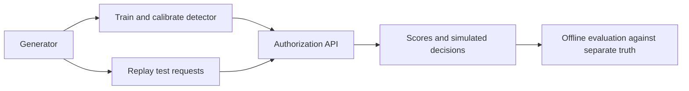

# Ticket-scalper detection: generate, train, authorize

Three components work together: the **generator** creates synthetic ticket-payment requests, the **detector** learns scalping patterns, and the **authorization API** scores new requests using that trained model. It returns a probability, observed evidence, and a simulated APPROVE, REVIEW, or DECLINE decision.



- [Generator guide](generation_and_testing/README.md): configuration, tactics, and source splits. Its original README is preserved.
- [Detector guide](detection/README.md): model features, CSV workflows, interpretation, and deployment limits.
- [Authorization guide](datathon_authorization/README.md): HTTP contract, state, validation, and replay.
- [Live demo guide](live_demo/README.md): newly generated purchases arriving over time, release surges, and live model decisions.

Run all commands below **from the repository root** on `feature/data-generator`. No generated dataset or pretrained model is committed. The API is a local demonstration: no bank is contacted and no payment, cancellation, or refund executes.

## 1. Install

Requires Python 3.10+.

```bash
python3 -m venv .venv
.venv/bin/python -m pip install -e './detection[dev,api]'
```

Reuse an existing `.venv/` by running only the install command. This installs PyTorch, NumPy, pandas, scikit-learn, FastAPI, Uvicorn, and the test tools. Optional ONNX checks require `-e './detection[dev,api,deploy]'`.

On Windows PowerShell, use `py -3 -m venv .venv`, replace `.venv/bin/python` with `.venv\Scripts\python.exe`, and replace `.venv/bin/scalper-detector` with `.venv\Scripts\scalper-detector.exe`. Put multiline Bash commands on one line.

## 2. Generate the training and test dataset

```bash
.venv/bin/python -m generation_and_testing.simulator.generate \
  --config generation_and_testing/configs/default.json \
  --output generation_and_testing/data/simulation
```

Choose a **new or empty output directory**; the generator refuses to overwrite data. If this directory already contains your dataset, skip generation and use it directly. For another run, choose a new directory and update subsequent `--simulation`, `--input`, and truth paths together.

The default configuration produces **11,640 requests**:

| Source split | Orders | Use |
| --- | ---: | --- |
| `train/` | 7,284 | Fit preprocessing and both models. |
| `validation/` | 1,728 | Separate linked groups for early stopping and calibration. |
| `test/` | 2,628 | Untouched final evaluation and API replay. |

Every split contains `requests.jsonl` and separate `ground_truth.jsonl`. `manifest.json` records configuration, chronological boundaries, counts, and tactics. The two requests in `datathon_authorization/authorization/sample_transactions.json` are a separate HTTP smoke sample; they are too small to train a model or measure accuracy.

## 3. Train

```bash
.venv/bin/scalper-detector train-simulation \
  --simulation generation_and_testing/data/simulation \
  --output artifacts/ticket_model \
  --epochs 20
```

Training joins labels to requests **offline** by `txn_id`. It preserves source train/test populations and held-out tactics. Only source validation is divided into early-stopping and calibration groups, with linked cards kept together. Preprocessing fits training orders only, and features use current or earlier requests.

The model directory contains `model.pt`, `tree.json`, `metadata.json`, `metrics.json`, `test_orders.csv`, `order_splits.csv`, and `simulation_evaluation.json`. The last report includes recall by scalping tactic and false positives on legitimate bulk buyers. Use another output directory when preserving an earlier model.

## 4. Start the authorization API — terminal 1

```bash
.venv/bin/python -m uvicorn datathon_authorization.authorization.main:app \
  --host 127.0.0.1 --port 8000 --workers 1
```

The default model directory is `artifacts/ticket_model`. The API loads it once at startup and fails clearly if it is missing or incompatible. For a different model, set `SCALPER_MODEL_DIR` before starting Uvicorn (`export SCALPER_MODEL_DIR=artifacts/another_model` in Bash; `$env:SCALPER_MODEL_DIR='artifacts/another_model'` in PowerShell).

Open [interactive API docs](http://127.0.0.1:8000/docs). Check readiness at [health](http://127.0.0.1:8000/health) and decision counts at [stats](http://127.0.0.1:8000/stats).

Use **one worker** and one globally chronological stream. History spans merchants so cross-site activity can affect later scores. It is held in memory and resets on restart. Duplicate IDs and late arrivals return HTTP 409 without changing valid history. Restart before replaying the same IDs or switching to an independent source split. Reloading the server also resets history.

## 5. Replay the test dataset — terminal 2

Start with a fresh server, then run:

```bash
.venv/bin/python -m datathon_authorization.replay \
  --input generation_and_testing/data/simulation/test/requests.jsonl \
  --output artifacts/api_responses.jsonl \
  --ground-truth generation_and_testing/data/simulation/test/ground_truth.jsonl \
  --evaluation-output artifacts/api_evaluation.json
```

This submits all 2,628 test requests, one at a time, in file order. Only request fields go to `POST /authorize`. Responses are saved first; separate ground truth is then joined locally for offline evaluation. The replay stops with a nonzero exit on invalid input, a network error, or a rejected request, instead of reporting an incomplete run as successful.

Inspect `artifacts/api_evaluation.json` for overall precision/recall/F1, per-tactic recall, and legitimate-bulk false positives. Compare with the training reports. The HTTP risk scores should agree with offline scoring when the same ordered stream, fresh history, model, and policy are used. Status counts and review-threshold metrics measure different cutoffs, as explained below.

For the original two-request smoke sample, **restart the server first** and run:

```bash
.venv/bin/python -m datathon_authorization.replay \
  --input datathon_authorization/authorization/sample_transactions.json \
  --output artifacts/sample_api_responses.jsonl
```

The sample's old fixed four-ticket rule has been replaced by the trained detector; specific APPROVE/DECLINE results are not hardcoded. This sample has no ground truth, so use it to check the HTTP flow.

## 6. Demonstrate live purchases

With a trained model and a **fresh** single-worker API running in terminal 1, start terminal 2 at the repository root:

```bash
.venv/bin/python -m live_demo
```

On Windows PowerShell, use `.venv\Scripts\python.exe -m live_demo`.

This separate online generator creates new purchases during the run, rather than replaying training/test files. The two-minute default mixes returning legitimate buyers, bulk-buying decoys, and four continuing scalper tactics. A release surge starts after 30 seconds. The terminal shows actual API decisions, risk scores, reasons, and HTTP latency as each purchase is scored. Logs and a summary are saved under `artifacts/live_demo/`.

Adjust `--duration`, `--rate`, `--scalper-ratio`, and release settings for your presentation. See the [live demo guide](live_demo/README.md) for details. The client preserves the API's required global order and reports delays when scoring cannot keep up. Restart the API between independent demos or replays.

## 7. Run the automated tests

```bash
.venv/bin/python -m pytest -q
```

The root configuration runs generator, detector, replay, and authorization tests. Tests train temporary models, send actual generated requests through FastAPI, compare HTTP and offline predictions, and check validation, missing events, cross-site history, duplicates, ordering, and state isolation. No running server or saved dataset is needed for this command.

For focused API checks:

```bash
.venv/bin/python -m pytest datathon_authorization/tests detection/tests/test_replay.py -q
```

For a repeatable offline check of the saved model:

```bash
.venv/bin/scalper-detector evaluate \
  --data artifacts/ticket_model/test_orders.csv \
  --model artifacts/ticket_model \
  --output artifacts/rechecked_evaluation.json
```

During this integration, **430 automated tests passed**, including optional ONNX checks. A real local Uvicorn run processed all **2,628 default test requests**; HTTP probabilities agreed with offline scores within `2.4e-7`, and reasons, review flags, actions, and event evidence matched. Both original sample requests also completed through HTTP.

For this default synthetic run, review-threshold precision was **99.60%**, recall **95.06%**, and F1 **97.28%**. Two of 379 legitimate-bulk orders were flagged. These figures describe this generator/configuration and model run; they are not real-world accuracy claims. Your saved reports are the source for your own run's results.

## Understand the response

| Field | Meaning |
| --- | --- |
| `scalper_probability` | Calibrated ensemble estimate from 0 to 1. |
| `risk_score` | Rounded display score from 0 to 100. |
| `authorization_status` | Simulated merchant-policy decision: `allow` → APPROVE; verification/throttle advice → REVIEW; cancel/refund advice → DECLINE. |
| `flagged_for_review`, `decision_threshold` | Whether probability meets the independently calibrated review threshold. |
| `confidence_tier`, `reason_codes` | Heuristic evidence quality and observed indicators, not proof of resale intent. |
| `model_result` | Full detector response, including event and cross-site evidence. |

The authorization status follows merchant action cutoffs; the review flag follows the calibrated review threshold. They can differ. All accepted requests, including those receiving simulated declines, enter **attempt history**. These totals do not establish completed purchases or enforce a real ticket allocation.

The API accepts the generator's ticket format, including missing event IDs and its longer transaction IDs, plus the original sample's decimal-string amounts. Explicit non-ticket categories and non-ticket MCCs are rejected. Amounts stay in USD units. Unknown release times and buyer allocations are not invented from request dates or generator settings.

Actor IDs, tactic names, and labels never become online input features. Synthetic metrics describe detectable simulated campaigns; they do not establish real ticket-scalper accuracy. Shared addresses or devices can belong to legitimate households and group buyers. CPU scoring is implemented; IBM Telum acceleration remains unverified.

## Common problems

| Problem | Fix |
| --- | --- |
| Import or command missing | Run the install command from the repository root with the shared `.venv/`. |
| API startup cannot load the model | Complete training first, or point `SCALPER_MODEL_DIR` to one complete model directory. |
| Generator says output is not empty | Reuse that dataset or choose a new output path; do not overwrite it. |
| Replay gets HTTP 409 | Restart the server for a fresh run; preserve source order and avoid mixing splits or samples. |
| Replay gets HTTP 422 | Inspect the error: tickets/USD/MCC 7922 only, valid quantities/tokens/timestamps, and no truth fields. |
| Counts differ from the table | The table describes the default config only; check your run's manifest. |

Generated datasets, `.venv/`, models, responses, and evaluation reports stay local under ignored `data/` and `artifacts/` directories. Source code and documentation are shared on `feature/data-generator`; `main` is unchanged.
