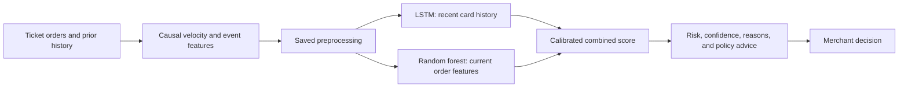

# Payment-Side Ticket Scalper Detection

A Python prototype that scores **ticket purchase orders** for patterns associated with scalping across ticketing sites. It combines a PyTorch LSTM with a random forest, then returns a risk estimate, observed evidence, a confidence tier, and a merchant action recommendation.

**Presentation pitch:** A ticketing site sees its own orders. A payment processor can see repeated purchases across participating sites. This project uses that wider payment history to help merchants review suspicious ticket buying while accounting for families, group bookings, and fans buying different events.

**Current state:** No transaction datasets, sample orders, or pretrained models are bundled. Generate synthetic authorizations with the companion simulator, or add your team's reviewed ticket data before training. You can install the project and run the automated tests immediately. The current implementation runs on CPU; IBM Telum deployment and hardware measurements remain future work.

## Contents

- [What the project does](#what-the-project-does)
- [Install and check the project](#install-and-check-the-project)
- [Use the companion simulator](#use-the-companion-simulator)
- [Prepare your ticket data](#prepare-your-ticket-data)
- [Train and evaluate a model](#train-and-evaluate-a-model)
- [Score orders and create a review report](#score-orders-and-create-a-review-report)
- [Understand the results](#understand-the-results)
- [Run the tests](#run-the-tests)
- [Presentation walkthrough](#presentation-walkthrough)
- [Benchmark and export](#benchmark-and-export)
- [Troubleshooting](#troubleshooting)
- [Project files and Git workflow](#project-files-and-git-workflow)

## What the project does

The detector covers **concert, sports, and theatre tickets**. Every input order must have `category=tickets`; other categories and mixed-category files are rejected.

For each order, it examines information available at that order's timestamp:

| Signal | What it helps reveal |
| --- | --- |
| Purchase frequency | Repeated orders on one card or linked group within short windows. |
| Activity across sites | The same card or linked group buying through multiple ticketing merchants. |
| Same-event accumulation | Multiple cards/sites collecting tickets for the same performance. |
| Shared identities | Cards connected by available address, email, or device tokens. |
| Event diversity | Rapid purchases for different performances, which can resemble suspicious frequency but describe a different pattern. |
| Allocation and timing | Observed ticket totals relative to a supplied event allocation, and activity around the on-sale time. |
| Data completeness | Missing quantities, unknown event IDs, short histories, and disagreement between the two models. |

The output is **one score per order**, rather than one permanent label per cardholder. Shared tokens and high quantities are evidence to examine, not proof that someone is a scalper. Recommendations never execute a block, quantity cap, cancellation, or refund; the merchant makes that decision.

### How an order moves through the system



The LSTM considers up to seven current/prior orders from the same card by default. Linked-card and cross-site context enters through the features attached to those orders. The forest evaluates the current feature row. Saved calibration parameters combine their estimates into the final score.

This is a payment-data workflow. It does not scrape ticket sites, collect checkout clickstream, or infer resale intent from listings. Cross-site detection requires an authorized feed with consistent card, identity, merchant, and event identifiers.

## Install and check the project

### 1. Open a terminal in the project root

Use the repository folder containing `detection/` and `generation_and_testing/`. All commands below run from that folder, with one shared `.venv/` environment.

Requirements are Python **3.10 or later**, a terminal, and internet access for the initial dependency installation. A GPU, IBM hardware, and TensorFlow are not required for the local workflow.

### 2. Create the environment and install dependencies

On macOS or Linux:

```bash
python3 --version
python3 -m venv .venv
.venv/bin/python -m pip install -e './detection[dev]'
```

This installs the project, PyTorch, NumPy, pandas, scikit-learn, and pytest. The explicit `.venv/bin/` paths keep every command in the same Python environment; activation is optional.

For Windows PowerShell, create/install with:

```powershell
py -3 -m venv .venv
.venv\Scripts\python.exe -m pip install -e './detection[dev]'
```

For the remaining commands, replace `.venv/bin/python` with `.venv\Scripts\python.exe` and `.venv/bin/scalper-detector` with `.venv\Scripts\scalper-detector.exe`. Run multiline Bash commands as single lines in PowerShell.

### 3. Check the installation

```bash
.venv/bin/scalper-detector --help
.venv/bin/python -m pytest -q
```

Tests construct temporary inputs and models themselves; they do not need a dataset in the repository. The root test command covers both the detector and generator, including their integration. Some ONNX checks skip when those optional packages are absent.

**What works before you add data:** command help, the generator, and automated tests. Training requires generated or team-supplied orders. Prediction, model evaluation, benchmarking, and export require a trained model.

## Use the companion simulator

The [repository quick start](../README.md) connects your friend's simulator to this detector. Its [original generator guide](../generation_and_testing/README.md) documents configuration and tactics.

```bash
.venv/bin/python -m generation_and_testing.simulator.generate \
  --config generation_and_testing/configs/default.json \
  --output generation_and_testing/data/simulation

.venv/bin/scalper-detector train-simulation \
  --simulation generation_and_testing/data/simulation \
  --output artifacts/ticket_model \
  --epochs 20

.venv/bin/scalper-detector predict-authorizations \
  --requests generation_and_testing/data/simulation/test/requests.jsonl \
  --model artifacts/ticket_model \
  --output artifacts/authorization_scores.csv
```

Choose a new or empty simulation output directory; the generator refuses to overwrite existing data. `train-simulation` joins each request to its separate truth record by `txn_id` for offline learning. It preserves the generator's chronological training and test populations, including held-out tactics. Only source validation is divided into early-stopping and calibration groups, with linked cards kept together. It writes the usual model outputs plus `simulation_evaluation.json`, which reports test recall by tactic and false positives on legitimate bulk buying.

Scoring reads requests alone. Actor IDs, tactic names, and labels never enter model features. Amounts retain the simulator's USD units. Unknown event allocations and release times remain unknown; the simulator's `quantity_cap` is not a per-buyer allocation. Synthetic results measure the simulator's assumptions and require validation on real ticket traffic.

## Prepare your ticket data

Create a local `data/` directory and add your files:

```bash
mkdir -p data
```

The filenames below are suggested paths used throughout this guide. **These files are not supplied by the project.** Change the command paths if your team chooses different names.

| Suggested file | Purpose |
| --- | --- |
| `data/ticket_orders.csv` | Historical ticket orders with labels for training. |
| `data/orders_to_score.csv` | Orders to score, including the prior history needed for their counters. Labels are optional and ignored by prediction. |
| `data/history.csv` | Earlier orders used to warm the single-order scoring session. |
| `data/order.json` | One new order to score after that history. Uses the same field names as a CSV row. |

Local data and generated artifacts are ignored by Git. The file in `detection/examples/`, [merchant_policy.json](examples/merchant_policy.json), is policy configuration rather than transaction data.

### Required fields

| Column | Expected value |
| --- | --- |
| `order_id` | Unique order/authorization identifier. Duplicate IDs are rejected. |
| `timestamp` | ISO 8601 order time. Use UTC with `Z` or an explicit offset; timezone-naive values are interpreted as UTC. |
| `card_id` | Stable token for a card, consistent across sites. Raw card numbers are unnecessary. |
| `card_bin` | Consistent issuer/product range identifier used for population velocity. A shared BIN does not link buyers. |
| `merchant_id` | Identifier for the ticketing merchant/site. |
| `category` | `tickets`. Leading/trailing spaces and capitalization are normalized. |
| `amount` | Finite positive total payment, in a consistently normalized currency and unit. |
| `is_scalper` | Required for training/evaluation: independently supplied `0` or `1` per order. Not required for scoring. |

### Optional fields that improve the evidence

| Column | Meaning |
| --- | --- |
| `event_id` | Common identifier for the same performance across sites. Use a specific show/game/date, not just an artist name or unrelated site-local IDs. |
| `quantity` | Positive whole number of tickets in the order. |
| `ticket_limit` | Positive whole event-level **per-buyer allocation applicable across sites**, when that allocation is actually known. It is not a per-order cap. |
| `shipping_hash`, `billing_hash` | Consistently tokenized addresses used for linkage. |
| `email_hash`, `device_id` | Consistent identity/device tokens, when available. |
| `seconds_since_release` | Nonnegative seconds since the ticket on-sale time at this order. |
| `card_age_days` | Nonnegative card age at the time of purchase, when known. |
| `card_type` | A source-supplied card category; missing values become `unknown`. |
| `processor_bin_orders_1m`, `processor_bin_orders_5m` | Optional wider processor counters. Supply both positive whole counts, including the current order; the five-minute count must be at least the one-minute count. |

Leave unknown optional values blank. Preprocessing records availability flags. Missing quantities do not contribute invented tickets to totals, and unknown event IDs never get combined into a shared "unknown event."

### Data checks before training

1. Include both positive and negative order labels. Fraud or chargeback labels are not automatically scalping labels.
2. Provide at least **four independent linked-card components per class**. Many rows on one linked buyer do not provide enough independent groups to split the data.
3. Keep event IDs and token namespaces consistent across sites. Empty identity tokens never link cards.
4. Include only information available at each order's time. Later investigations belong in labels, not in the earlier order's input features.
5. Include relevant prior activity. A file containing only newly arrived orders cannot reconstruct history that was never supplied.

See the [implementation guide](docs/implementation.md) for exact feature and missing-value behavior.

## Train and evaluate a model

### Train using your labeled history

After adding `data/ticket_orders.csv`:

```bash
.venv/bin/scalper-detector train \
  --data data/ticket_orders.csv \
  --data-source user_supplied \
  --output artifacts/ticket_model \
  --epochs 20 \
  --seed 42
```

The command prints epoch losses and held-out precision, recall, and F1. It saves the best neural weights, the forest, preprocessing, calibration, and evaluation outputs. `--epochs 20` is an upper bound: early stopping may finish sooner.

Training keeps whole linked-card components together in approximately these proportions:

| Partition | Share of components | Used for |
| --- | --- | --- |
| Training | 60% | Feature scaling/vocabularies and model fitting. |
| Validation | 15% | Neural early stopping and weight selection. |
| Calibration | 10% | Probability calibration and review-threshold selection. |
| Test | 15% | Final evaluation after fitting and selection. |

These are component proportions; exact card/order counts vary. Features use current and earlier information. Causal, unlabeled BIN population context is calculated before splitting so a smaller partition does not imply a quieter payment network. The saved held-out orders retain that context for repeatable evaluation.

By default, the calibration threshold maximizes F1. To target a particular calibration precision, add `--target-precision 0.9` to the training command. If that target cannot be reached, the report says so and records the fallback operating point. It does not guarantee 90% precision on future orders.

Use `train --help` to inspect other controls, including sequence length, hidden size, batch size, patience, learning rate, ensemble weight, and CPU threads. Use a new output directory when comparing runs: training writes into its chosen directory.

### Re-evaluate the saved model

```bash
.venv/bin/scalper-detector evaluate \
  --data artifacts/ticket_model/test_orders.csv \
  --model artifacts/ticket_model \
  --output artifacts/ticket_model/rechecked_evaluation.json
```

This reuses the saved model and threshold; it does not retrain. `evaluate` needs labels. To evaluate separately collected future orders, change `--data` to that labeled file and provide sufficient historical/population context.

The report evaluates **orders**, not independent people. Review precision, recall, and legitimate-buyer false positives together. Calibration/threshold-selection results are fitted selection results; held-out test metrics are the separate evaluation.

## Score orders and create a review report

Every command below explicitly selects `artifacts/ticket_model`. Run training first or supply the path to another compatible ticket model.

### Score a CSV of orders

```bash
.venv/bin/scalper-detector predict \
  --data data/orders_to_score.csv \
  --model artifacts/ticket_model \
  --output artifacts/presentation/order_scores.csv
```

Open `artifacts/presentation/order_scores.csv` in your editor or spreadsheet viewer. It contains one row per supplied order, sorted chronologically. The input should include relevant earlier history; older rows are scored too. Prediction ignores any `is_scalper` annotations.

To override the saved review cutoff for a run, add `--threshold 0.7`. This changes `flagged_for_review`, not the probability or merchant action-policy cutoffs.

### Score one new order with prior history

```bash
.venv/bin/scalper-detector score-order \
  --history data/history.csv \
  --order data/order.json \
  --model artifacts/ticket_model \
  --policy detection/examples/merchant_policy.json \
  --output artifacts/presentation/order_response.json
```

The response prints in the terminal and saves as JSON. `history.csv` must exclude the current `order_id` and all later activity. Each CLI invocation creates a fresh in-memory session, so previous CLI calls do not supply missing history automatically.

For an ongoing Python stream, load `ScalperDetector` from `scalper_detector.pipeline`, call `detector.new_session()`, warm it with `session.observe(order)`, and score subsequent chronological orders with `session.score_order(order)`. Session persistence and multi-worker coordination remain deployment work.

### Create a ranked post-purchase review list

```bash
.venv/bin/scalper-detector report \
  --data data/orders_to_score.csv \
  --model artifacts/ticket_model \
  --output artifacts/presentation/review_report.csv
```

The report prioritizes orders within the **same linked group and performance**. Later cluster evidence may bring an earlier order into review, but its original order-time probability stays unchanged. Separate review-priority and trigger fields identify that retrospective evidence. Risk does not propagate across unrelated performances or missing event IDs.

## Understand the results

| Output | How to explain it |
| --- | --- |
| `scalper_probability` | Model estimate from 0 to 1, dependent on your labels and training population. |
| `risk_score` | The same estimate on a 0–100 scale, rounded for display. |
| `confidence_tier` | Heuristic evidence quality: history, missing data, and model agreement. It is not the probability that the classification is correct. |
| `reason_codes`, `reason_details` | Observed indicators, such as repeated same-performance orders across sites. These are not causal model attributions or proof of resale intent. |
| `same_event_sites_5m`, `observed_event_tickets_24h` | Current performance's site count and known ticket accumulation. Missing quantities mean the ticket total may be incomplete. |
| `distinct_events_5m`, `same_event_order_fraction_5m` | Whether recent activity is spread across performances or concentrated on the current one. |
| `flagged_for_review`, `decision_threshold` | Whether the probability meets the calibrated or overridden review cutoff. |
| `recommended_action`, `policy_*` | Advisory action and the merchant cutoffs used to choose it. No action executes. |
| `limited_history`, `events_observed` | Whether the card has fewer orders than the configured sequence window. |

A high risk score can have low confidence when the pattern is suspicious but card history is short. A shared address can also connect several legitimate buyers. Present both the estimate and its evidence limitations.

### Merchant policy

The supplied [policy configuration](examples/merchant_policy.json) supports a default policy plus overrides keyed by your actual `merchant_id` values. The example override key has no effect unless your data contains that merchant ID.

| Default probability range | Risk tier | Recommendation |
| --- | --- | --- |
| Below 0.35 | Low | `allow` |
| 0.35 to below 0.65 | Medium | `step_up_verification` |
| 0.65 to below 0.85 | High | `quantity_cap_or_throttle` |
| 0.85 and above | Critical | `cancel_or_refund` |

The review cutoff and these action cutoffs are separate controls. Changing `--threshold` does not change policy recommendations; changing policy does not change the model score. Align them deliberately with the merchant's review process. `predict` and `report` also accept `--policy`.

### Metrics to discuss in a presentation

| Metric | Plain-language meaning |
| --- | --- |
| Precision | Among flagged orders, the proportion labeled as scalping. |
| Recall | Among orders labeled as scalping, the proportion flagged. |
| F1 | A combined precision/recall measure. |
| False-positive rate | Among legitimate orders, the proportion flagged. |
| Average precision / ROC AUC | Measures of how well scores rank positive and negative orders. |
| Brier score / log loss | Measures of probability quality; lower is better. |

Use results from your own reviewed data and describe the evaluation population. Automated tests demonstrate code behavior; they do not establish real-world detection accuracy.

## Run the tests

Run the complete suite:

```bash
.venv/bin/python -m pytest -q
```

Run focused checks while developing:

```bash
.venv/bin/python -m pytest detection/tests/test_data.py -q
.venv/bin/python -m pytest detection/tests/test_pipeline.py -q
.venv/bin/python -m pytest detection/tests/test_population_context.py -q
.venv/bin/python -m pytest detection/tests/test_authorizations.py detection/tests/test_simulation.py -q
```

| Test area | What it checks |
| --- | --- |
| Data and ticket scope | Input validation, duplicate IDs, missing fields, non-ticket rejection, event totals, and exact time-window boundaries. |
| Causality and linkage | Future events do not rewrite earlier features/scores; graph bridges merge observed history; missing tokens never link cards. |
| Model and metrics | Padded histories, ranking metrics, probability calibration, and precision-target threshold selection. |
| Pipeline and CLI | Training/reload, separate partitions, batch/streaming agreement, policy output, and review grouping. |
| Processor context | Wider BIN counts, local fallback, validation, and independence from labels. |
| Simulator integration | JSONL mapping, offline-only truth joins, preserved source splits, held-out tactics, and legitimate-bulk analysis. |
| Benchmark and deployment | Replay accounting, simulated pressure, and optional ONNX numerical parity. |

The tests create temporary synthetic fixtures as part of their assertions. They do not leave a transaction dataset or a trained demo model in the project. Older detector-only `generate`, `demo`, and `scenarios` commands remain available for experimentation. Use the companion generator and `train-simulation` for the integrated workflow.

To include ONNX verification:

```bash
.venv/bin/python -m pip install -e './detection[dev,deploy]'
.venv/bin/python -m pytest -q
```

## Presentation walkthrough

### Prepare before presenting

Install dependencies, generate a simulation or add your team's data, train the model, and run the tests beforehand. Confirm the input paths and the three model files exist. Training should not be the first step during the live presentation.

Choose orders in your data that illustrate ordinary fan purchases, family/group bookings, concentrated same-performance buying across sites/cards, and purchases spread across different performances. Treat these as examples to inspect, not guaranteed score outcomes or independent accuracy evidence.

### Suggested five-minute sequence

| Stage | Show | Explain |
| --- | --- | --- |
| 1. Problem | The opening pitch and feature table. | Why payment-side visibility can connect activity across ticketing sites. |
| 2. Inline result | Run `score-order` using the command above. | Risk, confidence, observed reasons, and the merchant's final decision. |
| 3. Broader activity | Run `predict` and open `order_scores.csv`. | Same-event accumulation compared with activity across different performances. |
| 4. Review workflow | Run `report` and open `review_report.csv`. | Later evidence can prioritize review without rewriting historical scores. |
| 5. Evidence and limits | Show `metrics.json` and the completed test output. | Precision/recall, legitimate-buyer false positives, and remaining real-world/hardware validation. |

Until you generate or supply data and train a model, present the architecture and automated tests; live scoring needs those inputs. The simulator quick start provides a request-scoring demonstration without preparing separate single-order files. Describe the current system as a local scoring prototype. The CLI simulates the transaction path; it is not a deployed payment API or a verified Telum service.

## Benchmark and export

After training, measure local CPU replay using your order stream:

```bash
.venv/bin/scalper-detector benchmark \
  --data data/orders_to_score.csv \
  --model artifacts/ticket_model \
  --orders 100 \
  --warmup 20 \
  --burst-rate 1000 \
  --output artifacts/presentation/benchmark.json
```

For 100 measured orders plus 20 warmup orders, supply at least 120 rows. Shorter input can measure fewer orders; input must exceed the warmup count.

The report distinguishes measured CPU service time from simulated arrival pressure and queue waiting. It includes p50/p95/p99 latency and serial replay throughput. It excludes network, persistent feature-store I/O, and concurrent authorization load. Both passes recompute BIN counters from replay input because supplied counters describe the original clock. A requested 1,000-order/second arrival rate is not a claim that the system sustains that throughput.

Export the neural branch when the optional deployment tools are installed:

```bash
.venv/bin/scalper-detector export-onnx \
  --model artifacts/ticket_model \
  --output artifacts/ticket_model/scalper_lstm.onnx
```

The export includes a manifest and CPU numerical checks. Feature state, the forest, calibration, reasons, and merchant policy remain outside the ONNX graph. IBM zDLC compilation, operator placement, and actual Telum latency/throughput need verification on the target hardware. See the [Telum deployment guide](docs/telum_deployment.md).

## Troubleshooting

| Problem | What to check |
| --- | --- |
| `.venv/bin/scalper-detector` is missing | Run the editable install from the project root using `.venv/bin/python`. On Windows, use the `Scripts` paths above. |
| A data path does not exist | Add your own file or correct `--data`, `--history`, or `--order`. No sample transactions are bundled. |
| `metadata.json` or model files are missing | Train first, then pass `--model artifacts/ticket_model`. CLI defaults for legacy synthetic helpers may point elsewhere. |
| A model format/feature-contract error appears | Retrain with the current code. Keep `model.pt`, `tree.json`, and `metadata.json` from the same run together. |
| Training needs four components per class | Add independent labeled buyer groups in both classes. More rows on the same linked cards do not solve this. |
| A non-ticket category is rejected | Supply only ticket orders with `category=tickets`; labeling another product as tickets is not a substitute for suitable data. |
| Duplicate order or out-of-order session error | Use unique IDs. Exclude the current order from history, and feed live sessions in nondecreasing timestamp order. |
| Event totals are missing or unexpectedly small | Check common performance IDs, observed quantities, and supplied history. Unknown values are not invented. |
| Cross-site orders are not linked | Check shared token namespaces and merchant/event identifiers. Separate exports cannot infer identities or activity absent from the feed. |
| Processor BIN count validation fails | Supply both counts or neither; both must be positive whole counts and five-minute count must be at least one-minute count. |
| ONNX tests skip or export tooling is missing | Install `./detection[deploy]`. Exporter warnings can occur; inspect the parity result and manifest rather than treating warnings as successful target-hardware validation. |
| A precision target is unmet | Inspect `threshold_selection` in `metrics.json`. Data quality, population, and the available model evidence limit achievable precision. |

## Project files and Git workflow

| Path | Purpose |
| --- | --- |
| `detection/src/scalper_detector/data.py` | Validation, causal features, linked components, and card-history windows. |
| `model.py`, `tree.py`, `pipeline.py` in that package | Neural/forest models, training, calibration, saving, scoring, and review. |
| `metrics.py`, `decision.py`, `service.py` | Evaluation, policy/evidence, and the stateful order-scoring session. |
| `cli.py`, `benchmark.py`, `deployment.py` | Commands, replay measurements, and neural export. |
| `authorizations.py`, `simulation.py` | Authorization JSONL mapping, source-split training, and offline tactic analysis. |
| `detection/tests/`, `generation_and_testing/tests/` | Automated regression and integration tests. |
| `detection/examples/merchant_policy.json` | Editable merchant policy configuration. |
| `generation_and_testing/` | Companion simulator, its configuration, and its preserved original README. |
| `data/` | Your local input data; ignored by Git. |
| `artifacts/ticket_model/` | Created by training: model files, `metrics.json`, `order_splits.csv`, and held-out `test_orders.csv`. Ignored by Git. |
| `artifacts/presentation/` | Your scoring, review, evaluation, and benchmark outputs. Ignored by Git. |
| `detection/docs/` | [Implementation detail](docs/implementation.md), [deployment](docs/telum_deployment.md), [Git workflow](docs/git_workflow.md), and the [preserved abstract](docs/project_abstract.txt). |

Work on the feature branch rather than `main`. Check the branch before committing:

```bash
git branch --show-current
git status --short
```

The integrated project is on `feature/data-generator`; the original detector branch is `feat/ticket-scalper-detection`. On the integration branch, review and save source/documentation changes with:

```bash
git add .gitignore README.md pytest.ini detection generation_and_testing
git diff --cached --stat
git commit -m "Update integrated ticket-scalper workflow"
git push -u origin feature/data-generator
```

Pushing the feature branch does not merge it into `main`. Input data, trained models, and the virtual environment are excluded. Commit your work before switching branches so uncommitted files do not follow you unexpectedly.
